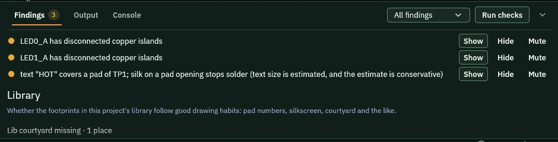

Checks look for problems in the schematic and the board. They run on every edit. Each problem is listed as a finding.

## Before you start

Open the example that has known findings:

```sh
cargo run -p pcbcraft -- --project examples/showcase-with-findings.pcbcraft
```

Click the **Layout** tab.

## Read the counts

1. Look at the right end of the status strip at the bottom of the window.
2. It shows the number of errors and warnings. This example shows 1 error and 2 warnings.

## Open the findings

1. Look at the bottom of the window. The tabs are **Findings**, **Output** and **Console**.
2. Click **Findings**, or open **View** and pick **Checks**. The panel opens.
3. Read the list. Each row has a coloured dot and a message.

   

The dot shows how serious a finding is. An error must be fixed before the board is built. A warning is worth a look. A note is for information.

4. Scroll down for the Library section. It lists findings about the footprints in your project library.

## Find the item

1. Click **Show** on a row.
2. The app selects the item on the drawing.

## Narrow the list

1. Click the box that says **All findings**.
2. Pick **Errors**, **Warnings** or **Notes**.

## Hide or mute a finding

1. Click **Hide** when you have looked at a finding and it is fine. Only that finding is hidden. A list below the findings brings hidden ones back.
2. Click **Mute** when a corner of the board is the way you want it. The check then leaves a box around those items alone. Clear the box in the list below to turn the check back on.

## Check again

1. Click **Run checks**. This checks the design again now.
2. The Output tab shows the last run, for example the number of errors, warnings and notes.

## What you should see

- Fixing the cause removes the finding from the list.
- The counts in the status strip go down.

## Related

- [Route the board](../route-board/)
- [The Layers tree](../layers-tree/)
