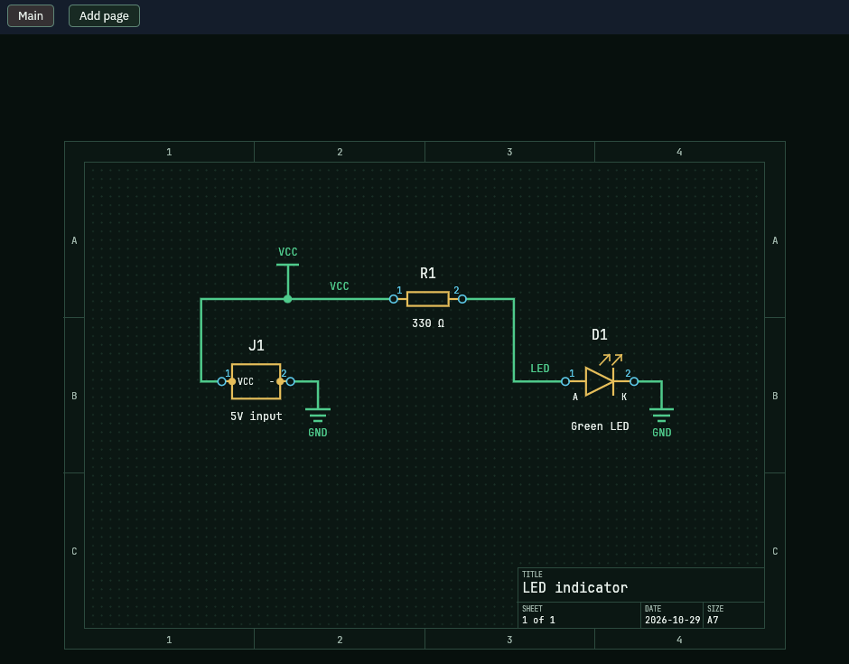

The schematic shows how the parts connect. You place parts and join their pins with wires. The board then gets the same parts and connections.

## Before you start

Open the sample with `cargo run -p pcbcraft -- --sample` and stay on the **Schematic** tab.

## Pick a tool

1. Look at the tool strip under the tabs.
2. The tools are **Select**, **Move**, **Place part**, **Wire**, **No connect** and **Measure**.
3. Hover a tool to read what it does. The active tool is outlined.

   

4. The buttons **Parts**, **Copper**, **Graphics** and **Text** decide what a click may pick up. Turn one off to leave that kind alone.

Press **Esc** at any time to go back to Select.

## Place a part

1. Click **Place part**. The Library opens with the search box ready.
2. Pick a card, for example **Resistor**.
3. Click the sheet where the part goes.

The Library page explains the other ways to place a part.

## Wire two pins

1. Click **Wire**, or press **W**.
2. Click the first pin. The status line reads: pick the first pin of the new wire.
3. Click the second pin. The wire is drawn and the tool goes back to Select.

   

You can also click a pin while Select is active. That starts a wire too. Right-click a pin and pick **Start wire** for the same result.

## Mark a pin as unused

1. Click **No connect**.
2. Click the pin that stays empty. Click it again to undo the mark.

## Undo a step

1. Open **Edit**.
2. Pick **Undo**, or press **Ctrl+Z**.

Every edit is one undoable step. **Redo** steps forward again.

## What you should see

- A wire joins the two pins you clicked.
- The board shows a dashed line between the matching pads, unless sync is off.

## Related

- [Place parts from the Library](../place-parts/)
- [Update the board from the schematic](../update-board-from-schematic/)
- [Route the board](../route-board/)
