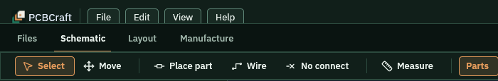
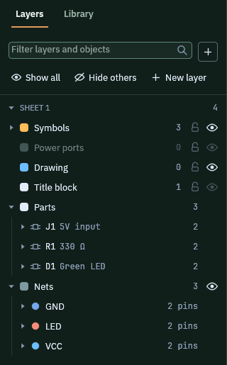

This page opens the small sample circuit. It has a 5 V input, a 330 ohm resistor and an LED. You will look at the window and move between the schematic and the board.

## Before you start

You need a clone of the repository and Rust installed. The app runs on your computer and needs no account.

## Open the sample

1. Run the sample from the root of the clone.

   ```sh
   cargo run -p pcbcraft -- --sample
   ```

2. Wait for the window to open. The schematic comes first.

   

   The sheet title says LED indicator. J1 feeds R1, and R1 feeds D1.

If you run the app without `--sample`, the Start screen opens first. Pick **Worked example** for this circuit, or **Showcase board** for a finished four-layer board.

## Read the top of the window

1. Look at the menus at the top left: File, Edit, View and Help.
2. Look at the row below them. The tabs are Files, Schematic, Layout and Manufacture.
3. Click **Layout** to see the board.

   

The board is 60 by 40 mm and holds the same three parts. Dashed lines join the pads that must be connected. No copper is drawn yet. Use **Schematic** to go back.

## Read the left panel

1. Click the **Layers** tab at the top of the left panel.
2. Find the groups **Symbols**, **Parts** and **Nets**.
3. Open **Parts** to see J1, R1 and D1. Open **Nets** to see GND, LED and VCC.

   

Click a row to select that item on the drawing. The next pages show what each row can do.

## What you should see

- The window title bar reads PCBCraft and the Schematic tab is selected.
- The status strip at the bottom shows the error and warning counts and the zoom.
- Layout shows a green board with three parts.

## Next

- [The Layers tree](../layers-tree/)
- [Place parts from the Library](../place-parts/)
- [Draw on the schematic](../draw-schematic/)
- [Update the board from the schematic](../update-board-from-schematic/)
- [Route the board](../route-board/)
- [Checks and findings](../checks/)
- [Save your design](../saving/)
- [Copper and drill plot files](../plot-files/)
