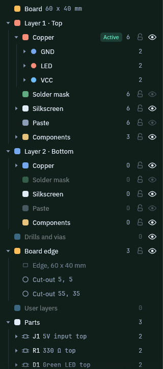
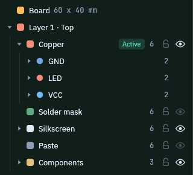
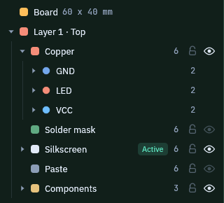
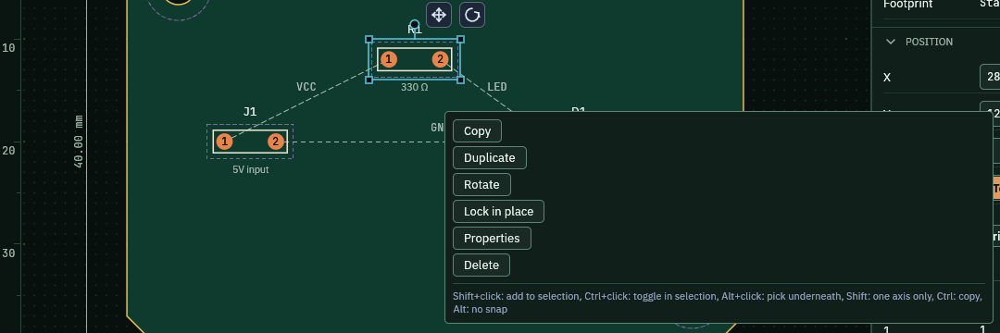

The Layers tree lists everything in the design in one place. Use it to pick a layer to draw on. You can also hide what is in the way and lock what must not change.

## Before you start

Open the sample with `cargo run -p pcbcraft -- --sample`. Click the **Layout** tab. The left panel opens on **Layers**.

## Read the tree

1. Find **Board** at the top. It shows the board size, 60 x 40 mm.
2. Find **Layer 1 · Top** and **Layer 2 · Bottom**. Each side has sublayers: Copper, Solder mask, Silkscreen, Paste and Components.
3. Open **Copper** on the top side. The nets GND, LED and VCC are listed under it.
4. Scroll down for **Board edge**, **User layers** and **Parts**.

   

The number on each row counts the items on it. The arrow at the left of a row opens or closes it.

## Hide and lock a layer

1. Click the eye at the right of a row to hide that layer on the drawing. Click it again to show it.
2. Click the small padlock to lock the layer. A locked layer cannot be picked or edited on the drawing.
3. A hidden layer shows a crossed eye. A faint eye means the drawing does not show that layer yet, so the eye does nothing. In the sample, Solder mask and Paste are like this.

   

Hiding changes only the view. The design is not changed.

You can also press **Space** to hide or show the layer under the pointer. Press **L** to lock or unlock it.

Use **Show all** above the tree to show every layer again. **Hide others** hides every layer except the one you are on.

## Pick the layer to draw on

1. Click a layer row, for example **Silkscreen** under Layer 1 · Top.
2. Look for the green **Active** tag. It moves to the row you clicked.
3. Draw as usual. New items go on the active layer.

   

## Pin a layer view

Clicking a layer row also pins the view, except for Board edge and user layers. Layers above it turn see-through, so the layer you chose is easy to read. A Viewing chip names the pinned layer.

1. Click a layer row to pin it.
2. Press **Page Up** or **Page Down** to move the pin one layer at a time.
3. Press **Esc**, click the cross on the Viewing chip, or use **Reset view** to drop the pin.
4. To dim everything that is not on a layer, press **F** over its row. Press **F** again to bring it all back.

Hovering a row shows the same see-through view while the pointer stays there. Nothing is pinned until you click.

## Right-click a row

1. Right-click a layer row.
2. Pick **Make active**, **Hide**, **Lock** or **Focus**. The shortcut keys are shown beside the names.
3. Right-click **Layer 1 · Top** to add a copper layer pair below it. Right-click an inner copper layer to rename it, move it up or down, or remove it.

Right-click on the drawing opens a different menu for the item under the pointer.

1. Right-click a part on the board, for example R1.
2. Pick **Copy**, **Duplicate**, **Rotate**, **Lock in place**, **Properties** or **Delete**.

   

## Find an item

1. Click the box that says **Filter layers and objects**.
2. Type a part reference, a net name or a layer name.
3. The tree keeps only the matching rows. Delete the text to see everything again.

## What you should see

- The Active tag follows the row you click.
- A hidden layer disappears from the drawing but stays in the tree, with a crossed eye.
- A locked layer ignores clicks on the drawing.

## Related

- [Route the board](../route-board/)
- [Checks and findings](../checks/)
