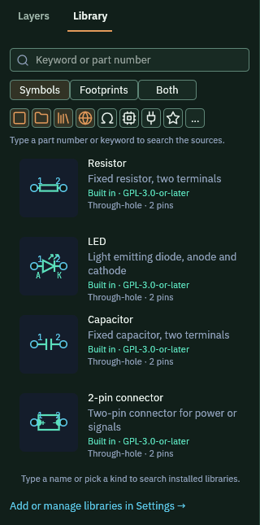
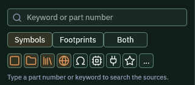
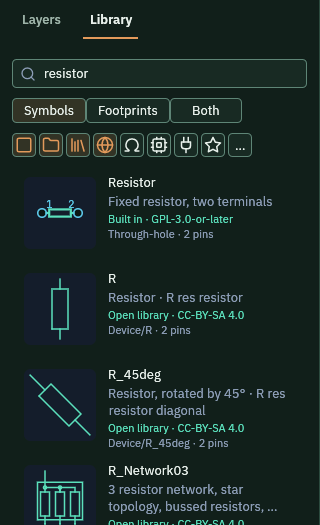
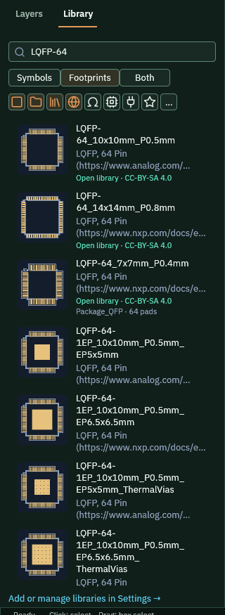

The Library lists the parts you can place. It lists four kinds of part. They are built in, saved in your project, installed on your computer and online.

## Before you start

Open the sample with `cargo run -p pcbcraft -- --sample`. The Schematic tab opens first.

## Open the Library

1. Click the **Library** tab at the top of the left panel. It sits beside **Layers**.
2. Read the cards. Each one shows a picture, a name, a short description, where it comes from and its pin count.

   

3. Choose what the cards show with **Symbols**, **Footprints** or **Both**. On the Layout tab the Library shows footprints.

## Narrow the list

1. Hover a small icon under the buttons to read its name. The icons filter by source: built in, this project, installed and online.
2. Three more icons filter by kind: passive parts, chips and connectors. The star keeps the parts you starred.
3. Click an icon again to clear it. The **...** button holds more filters, including Offline.

   

## Search

1. Click the box that says **Keyword or part number**.
2. Type a word, for example `resistor`.
3. The list shows the matches. Parts from the online source carry a line such as Open library and a licence.

   

## Place a part

Use any one of these ways.

1. Click a card, then click the sheet where the part goes.
2. Drag a card onto the schematic. The part lands where you let go.
3. Right-click a card and pick **Place on schematic**. The same menu can show the source and licence.

Dropping a part on the schematic adds only the symbol. Dropping a footprint on the board adds the footprint, and the part also joins the schematic. Its symbol waits at the left edge of the sheet until you move it.

The **Place part** button in the schematic tool strip opens the Library with the search box ready.

## Search online for a footprint

This needs a network connection.

1. Click the **Layout** tab, then the **Library** tab.
2. Type the package name, for example `LQFP-64`. Dashes and capitals do not matter.
3. Make sure the globe icon is on. It turns online results on.
4. Read the cards that appear. Each one names the package, the pin count and the licence.

   

5. Drag the card you want onto the board.

The footprint is fetched and placed with all its pads. A part with one schematic pin per pad is added too.

## What you should see

- The new part appears on the sheet or the board where you let go.
- The part count in the Layers tree goes up by one.
- The status strip says what the app just did.

## Related

- [Draw on the schematic](../draw-schematic/)
- [Route the board](../route-board/)
