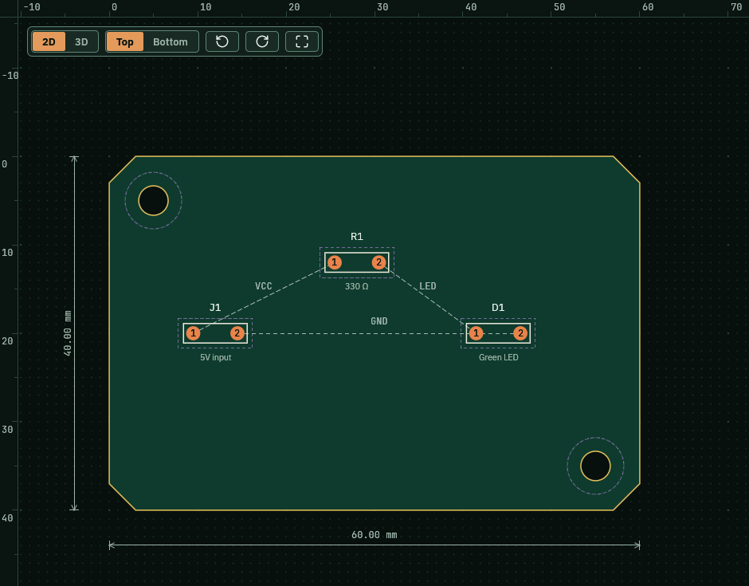
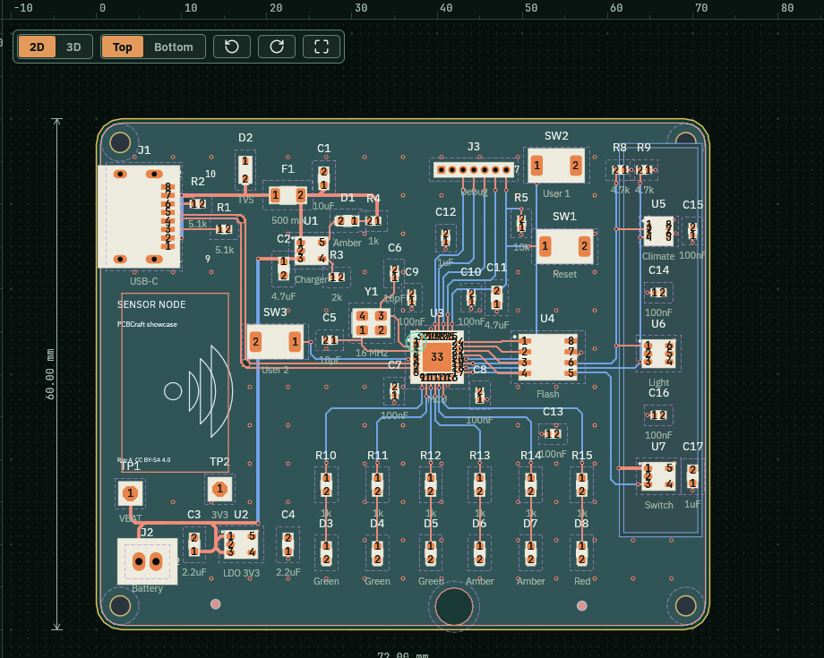

On the board, dashed lines show which pads must connect. Routing draws copper tracks along them.

## Before you start

Open the sample with `cargo run -p pcbcraft -- --sample`. Click the **Layout** tab.

## See what needs routing

1. Look at the board. Three parts sit on a 60 by 40 mm board.
2. Dashed lines join pads of the same net. They are labelled VCC, LED and GND.

   

## Pick the layer and the corners

1. In the Layers tree, find **Copper** under **Layer 1 · Top**. It carries the **Active** tag, so new tracks go on the top side.
2. Look at the **Corners** switch at the right end of the tool strip. **45** cuts corners at 45 degrees. **90** keeps them square.

The status strip shows the active layer, for example Layer 1 of 2 · Top copper. On the **Preferences** page the **Route on** entry also picks Top or Bottom.

## Route two pads

1. Click **Route** in the tool strip, or press **X**.
2. Click the first pad.
3. Click the second pad of the same net.

   

You can also press on the first pad and drag to the second pad. If you release off a pad, the app says the route is cancelled and changes nothing.

You can also right-click a pad and pick **Start route**.

## Add a via

1. Click **Via**.
2. Click a track or a pad. A via joins the copper layers on that net.

## A finished board

The Showcase board has a finished route. Open it with `cargo run -p pcbcraft -- --project examples/showcase.pcbcraft`.

Top copper is orange and bottom copper is blue. The Layers tree lists each net with its item count.

## If a route is refused

The app says why in the status strip and changes nothing. The sentence names the net that is in the way.

## What you should see

- A track joins the two pads you picked.
- The tool goes back to Select.

## Related

- [The Layers tree](../layers-tree/)
- [Copper and drill plot files](../plot-files/)
- [Checks and findings](../checks/)
