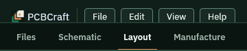
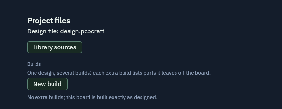

A design is one file with the extension `.pcbcraft`. Saving writes the whole design to that file.

## Before you start

Open the sample with `cargo run -p pcbcraft -- --sample` and make a change, for example move a part.

## Save

1. Click **File** at the top left.
2. Pick **Save**. The tip reads: write the design to its file on disk.
3. Or press **Ctrl+S**.

   

The status strip tells you what happened. Saving again replaces the file with the current design.

## Find the file

1. Click the **Files** tab.
2. Read the line **Design file**. It names the file the design is saved to.

   

A new design or the sample uses `design.pcbcraft` in the folder where you started the app. A design you opened keeps its own file name.

## Open a design again

1. Click **File**, then **Open**. The Start screen appears.
2. Click a design in the list of recent designs, or type a path in the box and click **Open**.

You can also start the app with a file:

```sh
cargo run -p pcbcraft -- --project design.pcbcraft
```

## Undo

Every edit is one undoable step. Use **Edit**, then **Undo**, or press **Ctrl+Z**, before you save if you change your mind.

## Limits

- The browser build cannot save. It says that saving needs the desktop app.
- There is no Save as command. To keep a second copy, copy the file in your file manager.

## What you should see

- The file exists in the folder after you save.
- It appears in the list of recent designs on the Start screen.
